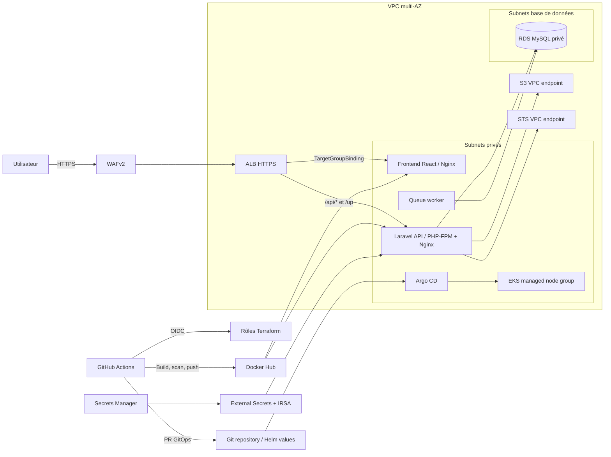

# Architecture TaskFlow — AWS EKS + GitOps

## Vue d'ensemble

## Correspondance des fichiers

| Fichier | Responsabilité |
|---|---|
| `vpc.tf` | VPC public/privé/database, NAT, routage, Flow Logs |
| `security.tf` | KMS, Security Groups, WAF, garde-fous de compte, accès Ops→EKS privé |
| `eks.tf` | EKS, managed node group, add-ons, OIDC IRSA, Access Entries administrateurs |
| `alb.tf` | ALB, listeners HTTPS, WAF, logs, target groups frontend/API |
| `rds.tf` | RDS MySQL privé, TLS, sauvegardes, secrets maître/app/migrator séparés |
| `s3.tf` | Bucket de fichiers privé, versioning, chiffrement, endpoints S3 et STS |
| `iam.tf` | OIDC GitHub (tf-plan/tf-apply), IRSA (VPC CNI, ESO, LB Controller, TaskFlow) |
| `helm/taskflow/` | Source de vérité des workloads applicatifs, Services, HPA, PDB, secrets et TargetGroupBindings |
| `gitops/applications/` | AppProject et Application Argo CD |

## Flux CI/CD de production

1. Pull Request : tests Laravel/React, scans secrets/SAST/IaC, validation Terraform, lint/rendu Helm et tests Conftest.
2. Merge sur `main` : après succès des jobs CI, GitHub Actions construit les images, les scanne avec Trivy, produit les SBOM CycloneDX, puis les publie sur Docker Hub avec un tag SHA.
3. Le workflow ouvre une PR qui met à jour `image.registry`, les repositories, `image.tag` et les digests API/frontend dans `helm/taskflow/values-eks.yaml`.
4. Après revue et merge de cette PR, Argo CD détecte le changement sur `main` et synchronise Helm dans le namespace `taskflow`.
5. Le Job Helm exécute les migrations avec un compte MySQL `migrator` séparé. L'API et le worker utilisent le compte `app` limité au CRUD.
6. Le workflow DAST ZAP baseline s'exécute manuellement ou selon son calendrier.

**GitHub Actions ne déploie jamais directement dans EKS** : aucun rôle GitHub n'a d'Access Entry Kubernetes; pas de `kubectl apply` ni de `helm upgrade` en production depuis le runner. Argo CD est le seul contrôleur GitOps applicatif.

## Choix d'architecture

- ALB, WAF, listeners TLS et target groups sont gérés par Terraform; AWS Load Balancer Controller ne fait que gérer les TargetGroupBindings.
- API Laravel : PHP-FPM et Nginx sidecar; frontend servi par Nginx non-root.
- `readOnlyRootFilesystem`, `runAsNonRoot`, `seccomp RuntimeDefault`, capabilities `drop: ALL`, NetworkPolicy et PDB.
- External Secrets synchronise `APP_KEY`, credentials runtime et credentials migration depuis Secrets Manager. Le compte maître RDS n'est jamais monté dans les pods.
- Les images applicatives sont hébergées sur Docker Hub; les digests SHA sont référencés dans Helm. Les HPA scalent les pods; le node group reste géré à capacité fixe par Terraform. Ajouter Cluster Autoscaler/Karpenter seulement si le besoin est établi.
- Le bucket S3 et IRSA sont préparés pour de futures pièces jointes. Le code actuel n'implémente pas encore le téléversement et garde `FILESYSTEM_DISK=local`; installer `league/flysystem-aws-s3-v3` et tester avant d'activer S3 dans Laravel.
- L'OIDC GitHub→AWS est distinct de l'authentification utilisateur : l'application actuelle utilise Laravel Sanctum et ne configure pas encore de fournisseur OIDC utilisateur.
