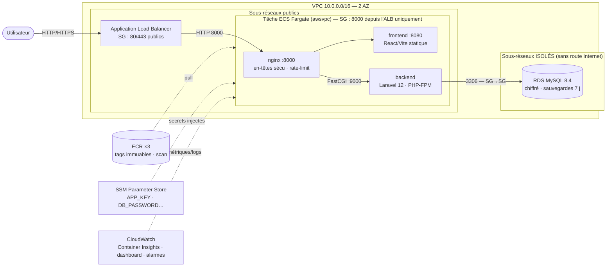
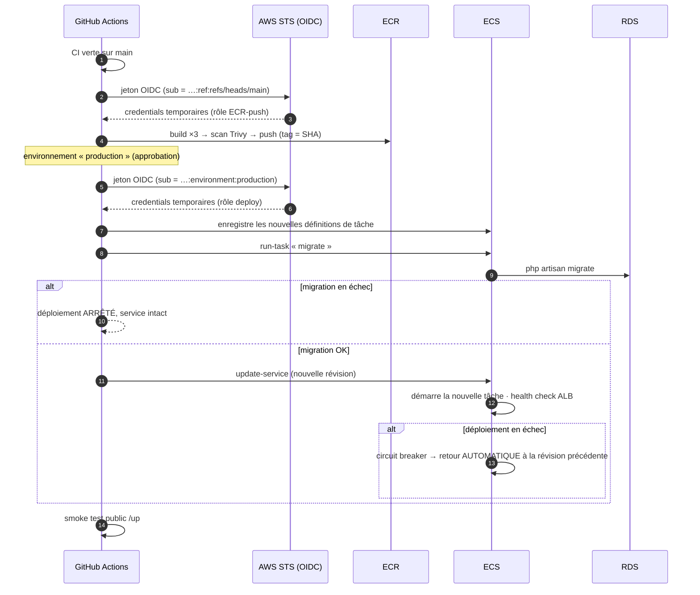

# Architecture (v2 — ECS Fargate + RDS)

> La v1 « instance unique » est conservée dans [`legacy/ec2/`](../../legacy/ec2/README.md). Le raisonnement de la migration est dans [l'étude de cas](../case-study/case-study.md).

## Vue d'ensemble

| Couche | Choix | Pourquoi |
|---|---|---|
| Entrée | ALB, health check `GET /up` (Laravel) | Terminaison TLS (ACM), redirection HTTP→HTTPS, retire les tâches malsaines |
| Calcul | **ECS Fargate**, 1 tâche = nginx + frontend + backend | Aucun serveur à patcher, déploiement progressif, rollback automatique |
| Base | **RDS MySQL** dans des sous-réseaux sans route Internet | Sauvegardes/PITR gérés, chiffrement, accessible seulement depuis les tâches |
| Réseau | Tâches en sous-réseau public + IP publique, SG `ALB → app` | Évite la NAT Gateway (~35 $/mois). Évolution : sous-réseaux privés + VPC endpoints |
| Admin | ECS Exec (SSM) | Aucun port SSH, session journalisée |
| Secrets | SSM Parameter Store → champ `secrets` des tâches | Générés par Terraform, jamais dans le code ni dans les variables GitHub |
| Images | ECR, tag = SHA du commit, immuable | Traçabilité + rollback exact |
| Observabilité | CloudWatch Container Insights + dashboard + alarmes SNS | Natif, sans serveur. Prometheus/Grafana : profil local |

## Déploiement (CD)

Rollback manuel : *Actions → CD → Run workflow* avec `image_tag` = tag précédent (même procédure, sans build).

## Limites connues (documentées)

- **Une seule tâche par défaut** (`DESIRED_COUNT=1`) : pas de haute disponibilité tant qu'on n'en lance pas deux ; RDS Multi-AZ via `db_multi_az = true`.
- **La base utilise l'utilisateur principal RDS** (pas d'utilisateur applicatif à droits réduits) : évolution recommandée.
- **Trafic ALB → tâche en HTTP** (TLS terminé à l'ALB, réseau privé du VPC).
- Les migrations ne sont pas annulées par un rollback : écrire des migrations rétro-compatibles (*expand / contract*).
- Les secrets Terraform sont dans le state : backend S3 chiffré (voir runbook).
