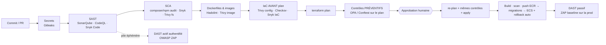

# Chaîne DevSecOps — où chaque contrôle intervient

| Workflow | Contrôle | Bloquant | Quand |
|---|---|---|---|
| `ci.yml` | Gitleaks, SonarQube, CodeQL, Snyk (SCA + Code), `composer audit`, `npm audit`, Trivy fs, Hadolint, Trivy image | Oui (Sonar/Snyk si token défini) | PR, push |
| `infra.yml` › `iac-security` | **Trivy config**, **Checkov**, **Snyk IaC**, Trivy secrets | Oui | PR/push touchant `infrastructure/**` — **avant tout plan** |
| `infra.yml` › `plan` | `terraform test` (mock), **contrôles préventifs OPA** sur le plan JSON + tests unitaires des politiques | Oui | Idem |
| `infra-test.yml` | `terraform test` avec providers simulés ; **apply réel sur LocalStack** (si `LOCALSTACK_AUTH_TOKEN`) | Oui | Chaque push touchant `infrastructure/**` |
| `infra.yml` › `apply` | Approbation, re-plan, **mêmes contrôles sur le plan réellement appliqué** | Oui | `main` |
| `dast.yml` | **ZAP baseline** + **scan actif authentifié de l'API** (spec OpenAPI) sur une pile éphémère aux images de production | Échec si alerte HIGH | PR, `main`, chaque lundi |
| `cd.yml` › `dast-prod` | ZAP baseline **passif** sur la production | Non (rapport) | Après chaque déploiement |

## Contrôles préventifs

« Préventif » = la mauvaise configuration **ne peut pas être créée**, au lieu d'être détectée après coup.

**1. Politiques as code** (`infrastructure/policy/guardrails.rego`, testées par `guardrails_test.rego`). Une violation fait échouer le pipeline :

| Règle | Interdit |
|---|---|
| RDS | Base non chiffrée ou publique |
| ECS | Service sans circuit breaker/rollback ; conteneur privilégié ; image `:latest` |
| Réseau | Ports autres que 80/443 ouverts à `0.0.0.0/0` ; SSH/RDP exposés ; règle « tous protocoles » |
| Calcul | Instance sans IMDSv2 ; volumes non chiffrés ; type d'instance hors liste (coût) |
| S3 | Bucket sans Block Public Access complet |
| ECR | Tags mutables ; scan à l'envoi désactivé |
| IAM | `AdministratorAccess` hors rôle d'apply ; politique `Action:* / Resource:*` ; confiance OIDC GitHub sans `sub` ou avec joker |
| Données | Suppression/remplacement d'un volume EBS ou d'un bucket (à faire à la main après sauvegarde) |

Ajouter une règle : éditer `guardrails.rego`, ajouter un test, `conftest verify -p infrastructure/policy`.

**2. Garde-fous de compte** (Terraform, `enable_account_guardrails`) : Block Public Access S3 au niveau du compte et chiffrement EBS par défaut dans la région.

**3. Séparation des pouvoirs** : le rôle `plan` est en lecture seule ; le rôle `apply` n'est assumable que depuis l'environnement GitHub protégé.

> Pour aller plus loin au niveau organisation : **AWS Organizations SCP** (interdire la désactivation de CloudTrail, restreindre les régions, interdire la création de clés d'accès IAM), ce qui nécessite un compte de gestion.

## Tester l'infrastructure avant de la déployer

1. **`terraform test` + `mock_provider`** (`infrastructure/terraform/tests/unit.tftest.hcl`) : vérifie des invariants (RDS chiffrée et privée, ECR immuable, circuit breaker actif, modes `demo_mode` vs production…) **sans aucun compte ni émulateur**. Toujours exécuté.
2. **LocalStack** (`infrastructure/localstack/`) : le provider est redirigé vers un AWS simulé par un fichier d'override (jamais utilisé en production), l'infra est **réellement appliquée**, testée (`tests-localstack/`), puis détruite. Les services de base sont gratuits ; **ECS, RDS, ELBv2 et ECR exigent, à notre connaissance, un `LOCALSTACK_AUTH_TOKEN`** — sans lui le job est simplement ignoré.
3. **Limite assumée** : LocalStack simule l'API, pas le comportement réel (pas de vrai conteneur PHP, réseau et IAM approximatifs). Il détecte les erreurs de configuration Terraform ; il **ne remplace pas** un vrai déploiement (voir `docs/deployment-checklist.md`).

## DAST (OWASP ZAP)

- **Pile éphémère** (`docker-compose.ci.yml`) : mêmes images que la production, `APP_ENV=production`, base vide, compte de test aux secrets aléatoires.
- **Baseline** : exploration passive du frontend (en-têtes, cookies, fuites d'information).
- **Scan actif de l'API** : ZAP importe `docs/openapi.yaml`, s'authentifie avec un jeton Sanctum éphémère (règle *replacer* → `Authorization: Bearer …`) puis attaque chaque route (injections, XSS, contrôle d'accès…). Plan : `.zap/plan.yaml`.
- **Gate** : le workflow échoue s'il reste une alerte **High** ; les *Medium* sont dans le rapport (artefact `zap-api-report`, HTML + JSON).
- **Jamais d'attaque active sur la production** : seulement le baseline passif après déploiement.
- Le rate-limit nginx est retiré dans la pile de test pour ne pas fausser la couverture ; il reste actif en production.
- Limite : tout le trafic ZAP est envoyé avec le jeton, donc les contrôles d'accès « sans authentification » sont peu testés ; ils le sont par les tests PHPUnit.

## Secrets à créer dans GitHub

| Nom | Type | Usage |
|---|---|---|
| `SNYK_TOKEN` | secret | Snyk (SCA, Code, IaC) — optionnel |
| `SONAR_TOKEN` | secret | SonarQube/SonarCloud — optionnel |
| `TF_STATE_BUCKET`, `AWS_TF_PLAN_ROLE_ARN`, `AWS_TF_APPLY_ROLE_ARN` | variables | Pipeline infra (voir runbook) |

## Mise au point au premier passage

Les scanners (Trivy, Checkov, Snyk, ZAP) n'ont **pas pu être exécutés** lors de la rédaction. Les exceptions de `.trivyignore` et `.checkov.yaml` sont des hypothèses justifiées : au premier run, examinez chaque échec, corrigez le code **ou** ajoutez une exception commentée — ne désactivez pas un scanner.
